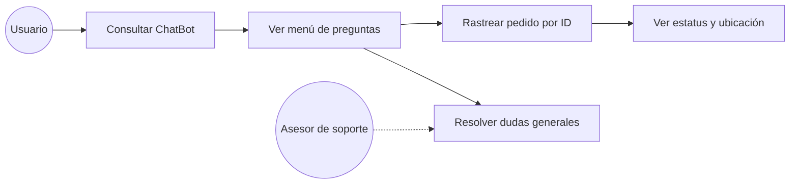
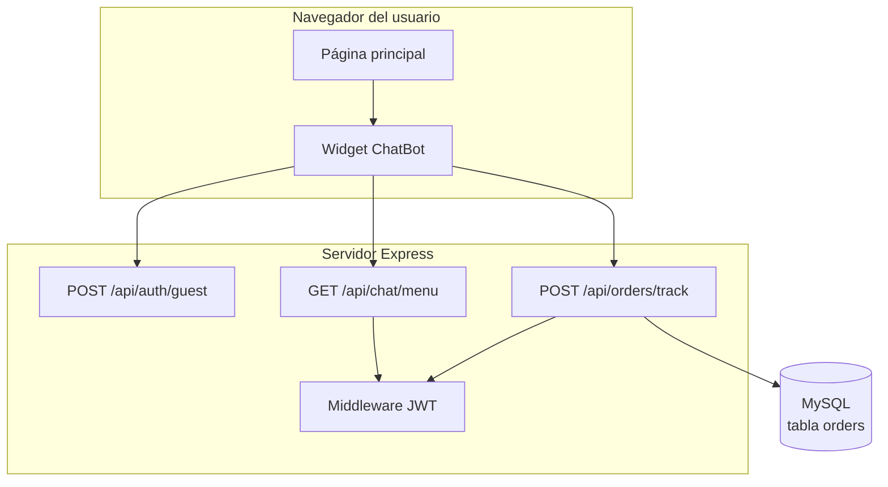
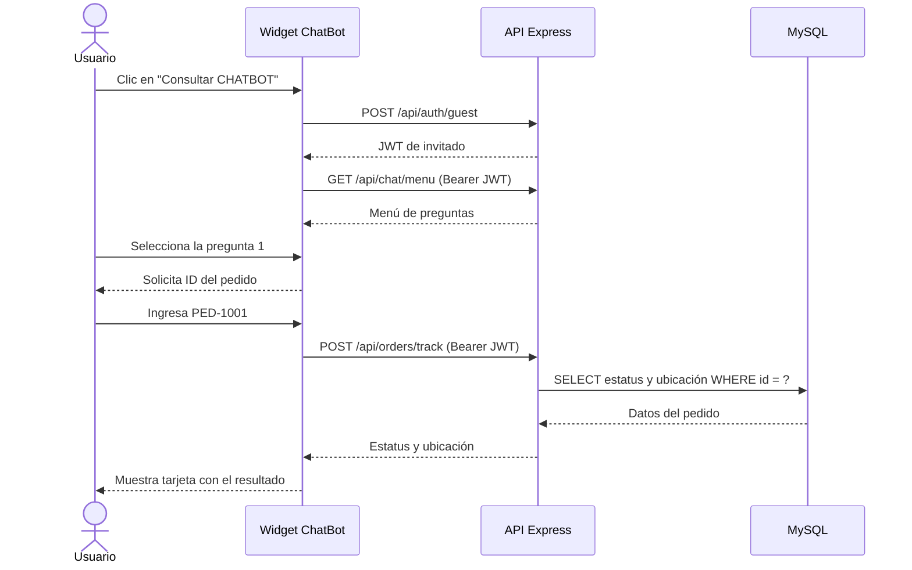

# Diagramas del proyecto (Mermaid)

Los diagramas se pueden visualizar en cualquier editor compatible con Mermaid
(por ejemplo, la extensión de Mermaid o mermaid.live).

## 1. Casos de uso

## 2. Arquitectura

## 3. Secuencia de rastreo de un pedido

