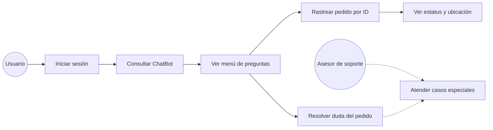
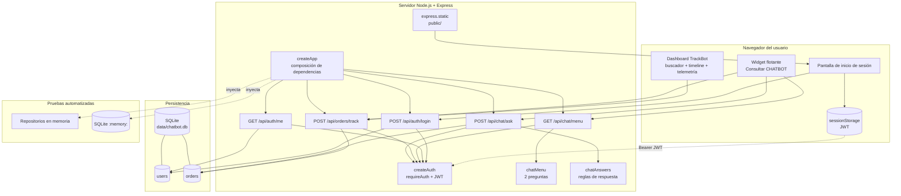
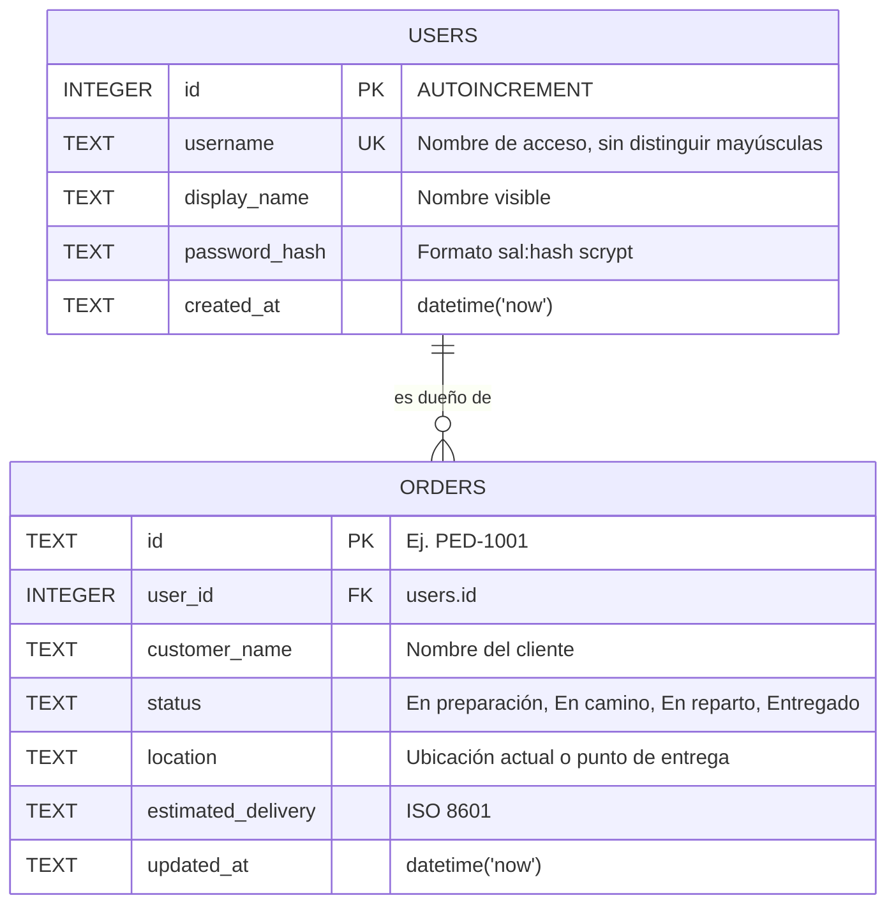
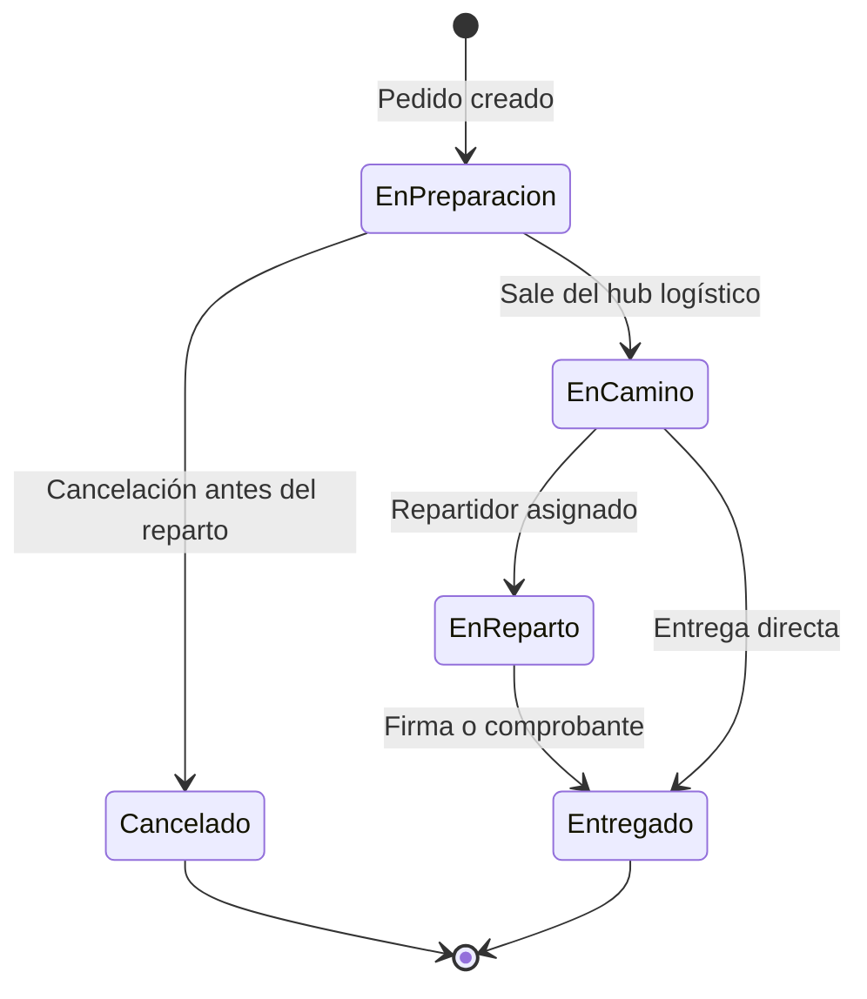
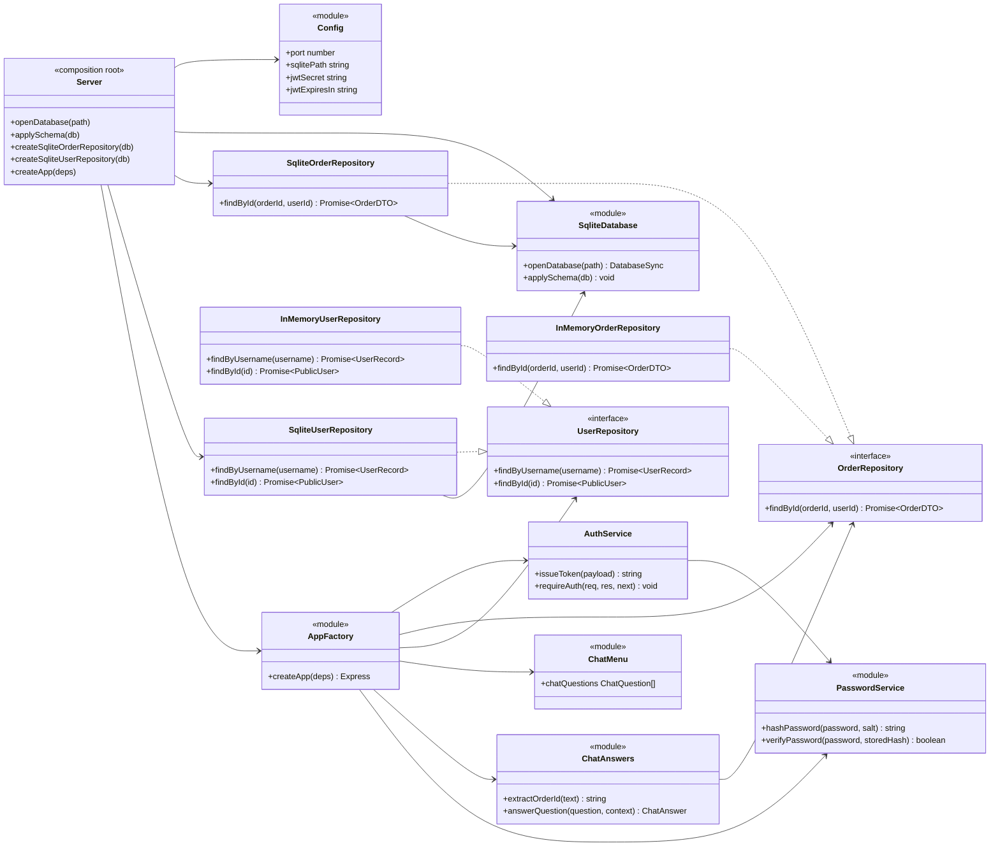
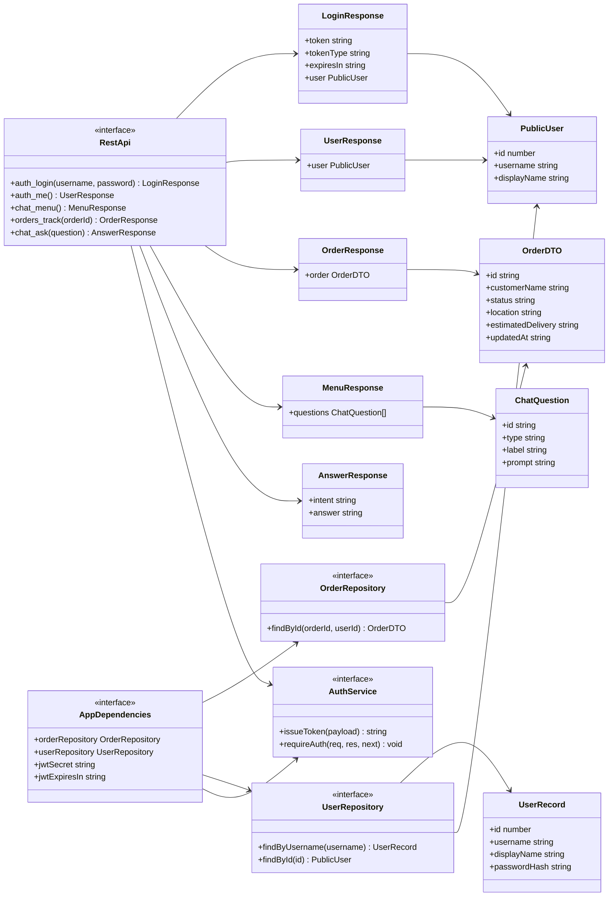
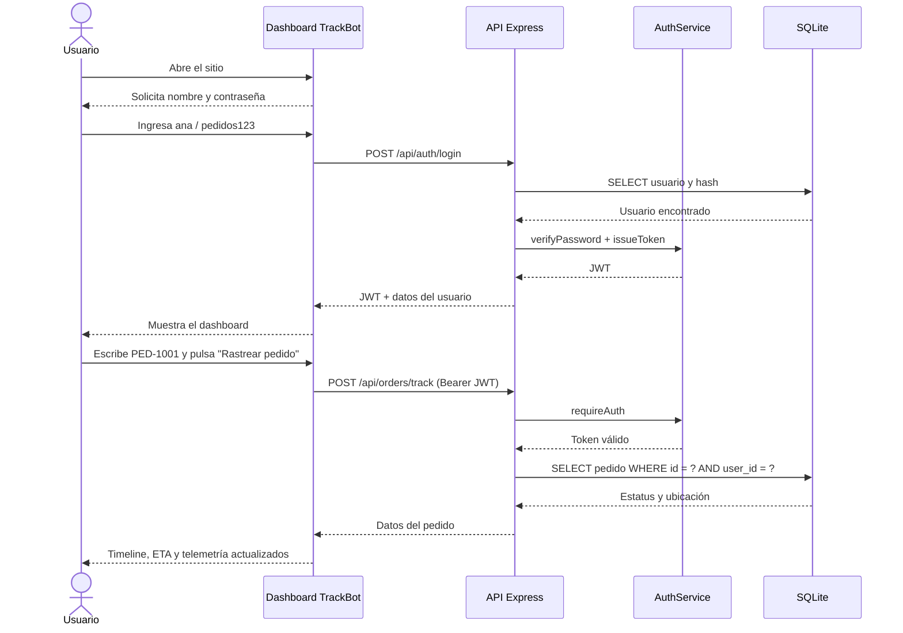
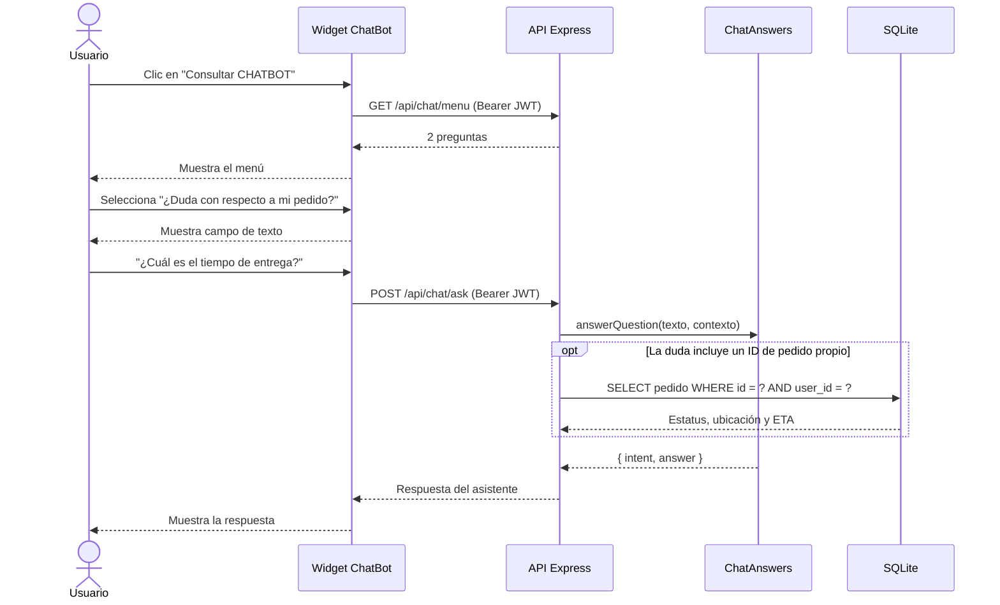

# Diagramas del proyecto (Mermaid)

Diagramas de arquitectura, modelo de datos, clases e interfaces del ChatBot de
rastreo de pedidos. Se pueden visualizar en cualquier editor compatible con
Mermaid (por ejemplo, la extensión de Mermaid o [mermaid.live](https://mermaid.live)).

---

## 1. Casos de uso



---

## 2. Arquitectura general

Arquitectura en capas: el navegador consume una API REST en Express; la API valida
el JWT, aplica las reglas del ChatBot y accede a SQLite mediante repositorios
inyectables. En las pruebas se sustituyen los repositorios SQLite por versiones en
memoria.



### Capas

| Capa | Responsabilidad | Archivos |
| --- | --- | --- |
| Presentación | Login, dashboard, widget, sesión en `sessionStorage` | `public/index.html`, `public/styles.css`, `public/chatbot.js` |
| API / aplicación | Rutas REST, validación, autenticación y composición | `src/app.js`, `src/auth.js`, `src/server.js` |
| Dominio | Menú de preguntas y reglas de respuesta | `src/chatMenu.js`, `src/chatAnswers.js` |
| Persistencia | Repositorios y acceso a SQLite | `src/db/*.js`, `db/schema.sql`, `db/seed.sql` |
| Configuración | Variables de entorno y secretos | `src/config.js`, `.env` |

---

## 3. Modelo de datos

### 3.1 Diagrama entidad-relación



### 3.2 Reglas del modelo

- Un usuario puede tener **muchos** pedidos; un pedido pertenece a **un solo** usuario.
- `orders.user_id` es llave foránea a `users.id` y se activa `PRAGMA foreign_keys = ON`.
- `users.username` es único y se compara con `COLLATE NOCASE`.
- `orders.id` es texto porque el identificador visible es `PED-1001`.
- El repositorio **siempre** filtra por `id` y `user_id`; un usuario no puede consultar
  pedidos ajenos aunque conozca el ID.
- Las contraseñas nunca se guardan en texto plano: `password_hash` almacena `sal:hash`
  generado con `scrypt`.

### 3.3 Índices

```sql
CREATE INDEX idx_orders_status ON orders (status);
CREATE INDEX idx_orders_user ON orders (user_id);
```

### 3.4 Diagrama de estados del pedido



La interfaz traduce el estado a un avance del timeline:

| Estado | Paso del timeline |
| --- | --- |
| `En preparación` | 2 · Procesado |
| `En camino` / `En reparto` | 3 · En camino |
| `Entregado` | 4 · Entrega |

---

## 4. Diagrama de clases

El backend usa módulos ES y funciones fábrica. Las “clases” de la API se representan
con sus responsabilidades; los repositorios son interfaces que se implementan con
SQLite o en memoria.



### Responsabilidades

| Módulo | Tipo | Responsabilidad |
| --- | --- | --- |
| `src/server.js` | Composición | Abre SQLite, arma repositorios y arranca Express. |
| `src/app.js` | Fábrica | Crea la app, registra rutas y aplica el middleware JWT. |
| `src/auth.js` | Servicio | Firma y valida JWT con `issuer` y expiración. |
| `src/passwords.js` | Servicio | Hash y verificación de contraseñas con `scrypt`. |
| `src/chatMenu.js` | Dominio | Expone las dos preguntas de RF_03. |
| `src/chatAnswers.js` | Dominio | Detecta intención y redacta la respuesta de RF_05. |
| `src/db/sqliteOrderRepository.js` | Persistencia | Consulta pedidos filtrando por dueño. |
| `src/db/sqliteUserRepository.js` | Persistencia | Busca usuarios por nombre o ID. |
| `test/support/inMemory*.js` | Pruebas | Implementaciones sustitutas sin base de datos. |

---

## 5. Interfaces y contratos

### 5.1 Diagrama de interfaces



### 5.2 Contratos de los repositorios

```ts
type UserId = string | number;

interface OrderDTO {
  id: string;
  customerName: string;
  status: string;
  location: string;
  estimatedDelivery: string | null;
  updatedAt: string;
}

interface UserRecord {
  id: number;
  username: string;
  displayName: string;
  passwordHash: string;
}

interface PublicUser {
  id: number;
  username: string;
  displayName: string;
}

interface OrderRepository {
  /** Devuelve null si el pedido no existe o no pertenece al usuario. */
  findById(orderId: string, userId: UserId): Promise<OrderDTO | null>;
}

interface UserRepository {
  findByUsername(username: string): Promise<UserRecord | null>;
  findById(id: UserId): Promise<PublicUser | null>;
}

interface AuthService {
  issueToken(payload: {
    sub: string;
    username: string;
    displayName: string;
    role: 'customer';
  }): string;

  requireAuth(req: Request, res: Response, next: NextFunction): void;
}

interface ChatQuestion {
  id: string;
  type: 'order-id' | 'free-text' | 'info';
  label: string;
  prompt?: string;
  answer?: string;
}

interface ChatAnswer {
  intent: 'delivery-time' | 'cancellation' | 'refund' | 'general';
  answer: string;
}

interface AppDependencies {
  orderRepository: OrderRepository;
  userRepository: UserRepository;
  jwtSecret: string;
  jwtExpiresIn?: string;
  logger?: Pick<Console, 'error'>;
}
```

### 5.3 Contratos HTTP

| Método | Ruta | Autenticación | Entrada | Salida |
| --- | --- | --- | --- | --- |
| `POST` | `/api/auth/login` | No | `{ username, password }` | `{ token, tokenType, expiresIn, user }` |
| `GET` | `/api/auth/me` | Bearer JWT | — | `{ user }` |
| `GET` | `/api/chat/menu` | Bearer JWT | — | `{ questions: ChatQuestion[] }` |
| `POST` | `/api/orders/track` | Bearer JWT | `{ orderId }` | `{ order: OrderDTO }` |
| `POST` | `/api/chat/ask` | Bearer JWT | `{ question }` | `{ intent, answer }` |
| `GET` | `/api/health` | No | — | `{ status: "ok" }` |

### 5.4 Formato de error

```json
{
  "error": {
    "code": "ORDER_NOT_FOUND",
    "message": "No encontramos un pedido con ese ID asociado a tu cuenta."
  }
}
```

| Código | HTTP | Cuándo ocurre |
| --- | --- | --- |
| `INVALID_CREDENTIALS` | 400 / 401 | Faltan datos o el usuario/contraseña no coinciden. |
| `UNAUTHORIZED` | 401 | Falta el JWT, es inválido o expiró. |
| `INVALID_ORDER_ID` | 400 | El ID está vacío o no cumple `^[A-Z0-9-]{4,32}$`. |
| `ORDER_NOT_FOUND` | 404 | El pedido no existe o pertenece a otra cuenta. |
| `INVALID_QUESTION` | 400 | La duda está vacía o supera 500 caracteres. |
| `INVALID_JSON` | 400 | El cuerpo de la solicitud no es JSON válido. |
| `INTERNAL_ERROR` | 500 | Error inesperado del servidor. |

---

## 6. Secuencia: inicio de sesión y rastreo (RF_01 y RF_04)



## 7. Secuencia: menú y duda general (RF_03 y RF_05)



---

## 8. Matriz de trazabilidad

| Requisito | Componentes | Pruebas |
| --- | --- | --- |
| RF_01 Inicio de sesión | Login, `POST /api/auth/login`, `auth.js`, `users` | PA-1 |
| RF_02 Consultar CHATBOT | `#chat-launcher`, `#assistant-cta` | PA-2 |
| RF_03 Menú de preguntas | `GET /api/chat/menu`, `chatMenu.js` | PA-3 |
| RF_04 Rastreo por ID | `POST /api/orders/track`, `sqliteOrderRepository.js` | PA-4 |
| RF_05 Dudas del pedido | `POST /api/chat/ask`, `chatAnswers.js` | PA-5 |
